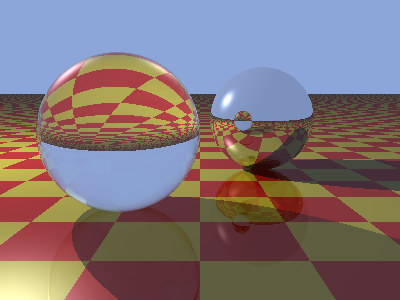
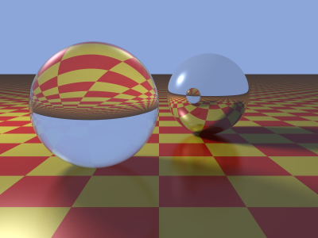

# Examples

Complete programs that use the library, each larger than a doc block's example can hold. They are listed by topic: a picture computed pixel by pixel, a figure drawn by recursion, a scene traced by several processes into one pixmap, a picture drawn with a graphics context, and a richer scene traced slowly enough to watch.

## Seeing them

On a machine with a screen, once `make test` has built them and with `ern` on your `PATH`, each one from the repository's root; the window closes on Enter:

```
ern run --load-path build --libs-dir lib examples/build/mandelbrot.erc build/mandelbrot.ppm show
ern run --load-path build --libs-dir lib examples/build/sierpinski.erc build/sierpinski.ppm show
ern run --load-path build --libs-dir lib examples/build/raytracer.erc build/raytracer.ppm 8 show
ern run --load-path build --libs-dir lib examples/build/clock_face.erc build/clock_face.ppm show
ern run --load-path build --libs-dir lib examples/build/whitted.erc build/whitted.ppm 8 4 show
```

The ray tracers take a count of workers, 8 above, and Whitted's spheres a count of samples after it: 4 fills the window in well under a minute on eight workers, and 16, the picture at the top of the README, takes about five minutes, each row appearing as a worker finishes it.

The word `show` opens a window of the picture's size before the program draws, shows the picture in it as the program's comment says, writes the file all the same, and leaves the window until Enter is pressed (`Epx.Window`); without the word nothing of the window happens, which is how `make test` runs them.

Each file begins with a comment that says what the program does, what to look at in it, and how to run it; what is named beside each is on the page of `Epx`, of `Epx.Gc` or of `Epx.Window`, a heading of its first part or a function.

The commands run from the repository's root once `make` has built the library, with `ern` on your `PATH`. `make test` builds every program here and runs each, writing its picture under `build/examples/`, and fails where one ends with a status other than 0.

| Program | What it is | What it shows | On the page |
|---|---|---|---|
| [`mandelbrot.ern`](mandelbrot.ern) | the Mandelbrot set, written to the file named as a PPM image | a pixmap written in place one pixel at a time, pure arithmetic beside the parts that act, the bytes of a file from `toPpm` | *In place and shared*, `toPpm`, `Epx.Window.show` |
| [`sierpinski.ern`](sierpinski.ern) | the Sierpinski gasket by recursive subdivision, written to the file named as a PPM image | a figure's definition as a function that calls itself three times, one pixmap written by every call | *In place and shared*, *Bounds*, `toPpm`, `Epx.Window`'s *Shown later* and `showArea` |
| [`raytracer.ern`](raytracer.ern) | the Boing ball above a mirror floor, ray traced by the count of workers named after the file, 1 where none is, and written to the file named as a PPM image | one pixmap captured by every worker and written a row at a time, a monitor and a `Down` for each worker, vector and color arithmetic beside the parts that act | *In place and shared*, *Rectangles*, `putPixels`, `toPpm`, `Epx.Window.showArea` |
| [`clock_face.ern`](clock_face.ern) | a clock's dial at the time the program runs, in UTC, written to the file named as a PPM image | one context set before each part it draws and read by the drawing functions, a hand drawn as a triangle so that it tapers to its tip, a thin line smoothed by `Antialiased` | `Epx.Gc`'s *The keys* and *In place and shared*, `drawEllipse`, `drawLine`, `drawTriangle`, `toPpm`, `Epx.Window.show` |
| [`whitted.ern`](whitted.ern) | a glass sphere and a mirror sphere over a checkered floor, ray traced by the count of workers named after the file with the count of samples named after that, each 1 where none is, and written to the file named as a PPM image | Cook's distributed ray tracing over a seed from `Random`, each ray of a pixel drawing its own point of the light and its own scattered reflection; each row traced from its own seed, so that the picture is the same whatever the count of workers; refraction and Fresnel beside reflection; the acting half of `raytracer.ern` unchanged | *In place and shared*, *Rectangles*, `putPixels`, `toPpm`, `Epx.Window.showArea` |

Each is built with the library on the load path, `--load-path build`, and run with epx and tree_db beside it, `--libs-dir lib`, as its first comment shows.

## The pictures

What each program draws, from `assets/`, where [`assets/README.md`](../assets/README.md) says how a picture is made.

`mandelbrot.ern`:


`sierpinski.ern`:


`raytracer.ern`:


`clock_face.ern`:


`whitted.ern`, with one sample, as `make test` runs it, and with sixteen:




