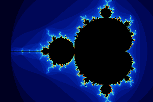
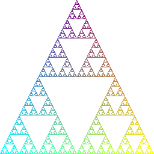
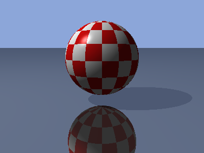
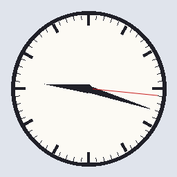

# Examples

Complete programs that use the library, each larger than a doc block's example can hold. They are listed by topic: a picture computed pixel by pixel, a figure drawn by recursion, a scene traced by several processes into one pixmap, and a picture drawn with a graphics context. Each file begins with a comment that says what the program does, what to look at in it, and how to run it; what is named beside each is on the page of `Epx`, of `Epx.Gc` or of `Epx.Screen`, a heading of its first part or a function.

The commands run from the repository's root once `make` has built the library, with `ern` on your `PATH`. `make test` builds every program here and runs each, writing its picture under `build/examples/`, and fails where one ends with a status other than 0.

Each program also takes the word `show` after its other arguments, on a machine with a screen: it then opens a window of its picture's size before it draws, shows the picture in it as its comment says, writes its file, and leaves the window on the screen until Enter is pressed (`Epx.Screen`). `make test` runs them without the word, and opens no window.

| Program | What it is | What it shows | On the page |
|---|---|---|---|
| [`mandelbrot.ern`](mandelbrot.ern) | the Mandelbrot set, written to the file named as a PPM image | a pixmap written in place one pixel at a time, pure arithmetic beside the parts that act, the bytes of a file from `toPpm` | *In place and shared*, `toPpm`, `Epx.Screen.show` |
| [`sierpinski.ern`](sierpinski.ern) | the Sierpinski gasket by recursive subdivision, written to the file named as a PPM image | a figure's definition as a function that calls itself three times, one pixmap written by every call | *In place and shared*, *Bounds*, `toPpm`, `Epx.Screen`'s *Shown later* and `showArea` |
| [`raytracer.ern`](raytracer.ern) | the Boing ball above a mirror floor, ray traced by the count of workers named after the file, 1 where none is, and written to the file named as a PPM image | one pixmap captured by every worker and written a row at a time, a monitor and a `Down` for each worker, vector and color arithmetic beside the parts that act | *In place and shared*, *Rectangles*, `putPixels`, `toPpm`, `Epx.Screen.showArea` |
| [`clock_face.ern`](clock_face.ern) | a clock's dial at the time the program runs, in UTC, written to the file named as a PPM image | one context set before each part it draws and read by the drawing functions, a hand drawn as a triangle where a wide line would lie beside its ends, a thin line smoothed by `Antialiased` | `Epx.Gc`'s *The keys* and *In place and shared*, `drawEllipse`, `drawLine`, `drawTriangle`, `toPpm`, `Epx.Screen.show` |

Each is built and run with the library, epx and tree_db on the load path, `--load-path build --load-path lib/epx/ebin --load-path lib/tree_db/ebin`, as its first comment shows.

## The pictures

What each program draws, from `assets/`, where [`assets/README.md`](../assets/README.md) says how a picture is made.

`mandelbrot.ern`:

`sierpinski.ern`:

`raytracer.ern`:

`clock_face.ern`:

